<div align="center">


<p align="center">
  
</p>

[](https://openjdk.org/)
[](https://spring.io/projects/spring-boot)
[](https://spring.io/projects/spring-ai)
[](https://groq.com/)
[](https://modelcontextprotocol.io/)
[](#-flagship-pattern-saga-rollback-for-agents)

<br/>

<div align="center">

<a href="https://gaurav7131.github.io/Agentic-AI/Enterprise-19-Patterns-Visual.html" target="_blank">
  
</a>

<a href="https://gaurav7131.github.io/Agentic-AI/Enterprise-19-Patterns-Visual.html#pattern-16-saga" target="_blank">
  
</a>

</div>

<p align="center">
  <sub>19 interactive, animated pattern simulations — zero installation needed. Click <b>RUN SAGA DEMO</b> to inspect real-time LIFO compensation.</sub>
</p>

</div>

---

> [!TIP]
> **How to navigate this reference:**
>
> - **Interactive Visual Dashboard:** Test all 19 patterns natively in [`Enterprise-19-Patterns-Visual.html`](./Enterprise-19-Patterns-Visual.html).
> - **Architecture Workflows:** Animated diagrams loop dynamically (`assets/`), and system state flows render via GitHub Mermaid.
> - **Production Code:** Each pattern contains concrete Java 21 / Spring Boot 3 implementations directly extracted from the codebase.

> [!IMPORTANT]
> **The \$2,800 Autonomous Agent Trap:** An unconstrained ReAct agent was provisioned to configure cloud infrastructure. Step 4 timed out (`504 Gateway Timeout`), crashing the orchestrator thread. The preceding resources (`VirtualNetwork`, `Subnets`, `Storage`) remained orphaned and running for 14 days without tags or alerts, generating a \$2,800 bill.
>
> This repository solves the stability, budget, and security bottlenecks causing 90% of Agentic AI prototypes to fail in enterprise environments. See [§16 Plan-and-Solve with Saga](#16--plan-and-solve-with-saga-compensation) for the transactional fix.

---

## 📚 Table of Contents

- [1. System Architecture Overview](#-system-architecture-overview)
- [2. Competency & Skill Mapping](#-competency--skill-mapping)
- [3. Flagship Pattern: Saga Rollback for Agents](#-flagship-pattern-saga-rollback-for-agents)
- [4. The 19 Enterprise Patterns Taxonomy](#-the-19-enterprise-patterns-taxonomy)
- [5. Detailed Architectural Lessons](#-detailed-architectural-lessons)
  - [Foundations (01–03)](#-foundations-0103)
  - [Knowledge & Action (04–06)](#-knowledge--action-0406)
  - [Trust & Operations (07–09)](#-trust--operations-0709)
  - [Orchestration (10–11)](#-orchestration-1011)
  - [Cost & Memory (12–13)](#-cost--memory-1213)
  - [Security & Adaptive Retrieval (14–17)](#-security--adaptive-retrieval-1417)
  - [Routing & Master Build (18–19)](#-routing--master-build-1819)
- [6. Multi-Module Project Structure](#-multi-module-project-structure)
- [7. Setup & Local Verification](#-setup--local-verification)
- [8. Production Verification & Proof-of-Work](#-production-verification--proof-of-work)
- [9. Suggested Learning Roadmap](#-suggested-learning-roadmap)
- [10. Glossary & Troubleshooting](#-glossary--troubleshooting)
- [11. Author & Connect](#-author--connect)

---

## 🏗 System Architecture Overview

flowchart LR
subgraph INGRESS["1. Ingress & Edge Protection"]
U["REST / SSE / MCP Host"] --> R["Dynamic Router & Semantic Cache"]
R -->|"Cache Hit (<20ms)"| CACHE[("Memory Store")]
end

subgraph ORCHESTRATION["2. Enterprise Orchestration"]
R -->|"Cache Miss"| S["Master Supervisor Orchestrator"]
S --> A1["Subagent: IT Triage"]
S --> A2["Subagent: Accounts & Billing"]
A1 & A2 --> T["@Tool Services"]
S --> RAG["Corrective RAG Advisor"]
RAG --> VS[("Vector Store / ANN")]
S --> M[("Tiered Memory Store")]
T --> H{"HITL Gate ($ > 500)"}
end

subgraph INFERENCE["3. Asymmetric Compute"]
S --> F["Fast Tier: Llama 3.1 8B (Groq LPU)"]
F -. "Escalate (tau < 0.85)" .-> P["Frontier Tier: GPT-4o / Claude 3.5"]
end

subgraph TARGETS["4. Verified Execution"]
H -->|"Approved / Compensated"| BE[("Enterprise Infrastructure")]
end

---

## 📚 Table of Contents

1. [What is this repo?](#-what-is-this-repo)
2. [Who is it for & how to use it](#-who-is-it-for--how-to-use-it)
3. [Prerequisites](#-prerequisites)
4. [Core concepts in 5 minutes](#-core-concepts-in-5-minutes)
5. [Repository structure](#-repository-structure)
6. [Setup & run](#-setup--run)
7. [Module 1 — spring-ai-groq](#-module-1--spring-ai-groq)
8. [Module 2 — spring-ai-mcp-server](#-module-2--spring-ai-mcp-server)
9. [The 19 patterns — overview table](#-the-19-enterprise-patterns--overview)
10. [The 19 patterns — detailed lessons](#-the-19-patterns--detailed-lessons)
11. [Suggested learning path](#-suggested-learning-path)
12. [Glossary](#-glossary)
13. [Troubleshooting & FAQ](#-troubleshooting--faq)
14. [Author](#-author)

---

## ✨ What is this repo?

An **end-to-end, hands-on guide to building AI agents with Java and Spring**. It contains:

| What                                                                                              | Where                                              |
| ------------------------------------------------------------------------------------------------- | -------------------------------------------------- |
| A runnable Spring AI app using the **Groq** LLM API (chat, streaming, memory, RAG, tools)         | [`spring-ai-groq`](spring-ai-groq)                 |
| A runnable **MCP (Model Context Protocol) server** that exposes Java methods as AI tools          | [`spring-ai-mcp-server`](spring-ai-mcp-server)     |
| **19 production patterns**, each explained with _problem → idea → how it works → code → pitfalls_ | [this README](#-the-19-patterns--detailed-lessons) |
| **Proof-of-work screenshots** of the apps actually running                                        | `src/main/resources/templates/POW` in each module  |

> 💡 **Goal:** after reading this, a beginner who knows basic Java should understand _what_ each pattern is, _why_ it exists, and _how_ to implement it with Spring AI.

## 🎯 Who is it for & how to use it

- **Beginners:** read [Core concepts](#-core-concepts-in-5-minutes) → run Module 1 → read patterns 01–05.
- **Intermediate:** jump to patterns 06–13 (MCP, observability, evaluation, HITL, supervisor, graphs, caching, memory).
- **Advanced:** patterns 14–19 (security, tool pruning, saga, corrective RAG, cascading routers, production build).

Every pattern is a collapsible section: the summary is always visible, click to expand the deep-dive.

## ✅ Prerequisites

| Requirement        | Version                         | Why                                     |
| ------------------ | ------------------------------- | --------------------------------------- |
| JDK                | 21                              | Records, virtual threads, modern syntax |
| Maven              | 3.9+ (or the included `./mvnw`) | Build tool                              |
| Groq API key       | free tier at console.groq.com   | The LLM provider used in Module 1       |
| Redis _(optional)_ | 7+                              | Only for pattern 09 (HITL state)        |
| Basic knowledge    | Java, Spring Boot, REST         | You do **not** need prior AI experience |

## 🧠 Core concepts in 5 minutes

| Term             | Plain-English meaning                                                                                 |
| ---------------- | ----------------------------------------------------------------------------------------------------- |
| **LLM**          | A text-prediction model (e.g. Llama). You send text, it sends text back.                              |
| **Prompt**       | The text you send. Has a _system_ part (rules) and _user_ part (question).                            |
| **Token**        | A chunk of text (~¾ of a word). You pay and are rate-limited per token.                               |
| **Streaming**    | Receiving the answer token-by-token instead of waiting for the whole thing.                           |
| **Embedding**    | A list of numbers representing the _meaning_ of a text.                                               |
| **Vector store** | A database that finds texts with similar meaning (cosine similarity).                                 |
| **RAG**          | Retrieval-Augmented Generation: look up your own documents first, then let the LLM answer using them. |
| **Tool calling** | The LLM asks _your code_ to run a function (e.g. `getWeather`) and uses the result.                   |
| **Agent**        | An LLM in a loop: think → call a tool → observe → think again, until done.                            |
| **MCP**          | A standard protocol so any AI client can discover and call tools on any server.                       |

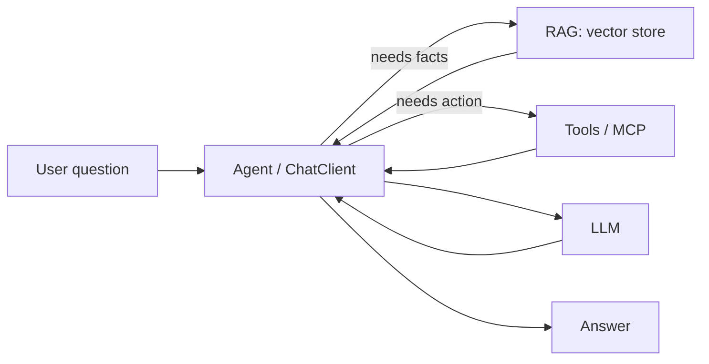

## 🗂️ Repository structure

> Adjust names if your folders differ.

```text
Agentic-AI/
├── README.md                       ← you are here
├── assets/                         ← animated architecture SVGs
├── spring-ai-groq/
│   ├── pom.xml
│   └── src/main/
│       ├── java/...                ← controllers, config, services
│       └── resources/
│           ├── application.properties
│           └── templates/POW/      ← proof-of-work screenshots
└── spring-ai-mcp-server/
    ├── pom.xml
    └── src/main/
        ├── java/...                ← @Tool classes, MCP config
        └── resources/
            ├── application.properties
            └── templates/POW/      ← proof-of-work screenshots
```

## 🚀 Setup & run

**1. Clone**

```bash
git clone https://github.com/Gaurav7131/Agentic-AI.git
cd Agentic-AI
```

**2. Get a Groq key** at <https://console.groq.com> and export it (never commit it):

```bash
# macOS / Linux
export GROQ_API_KEY=your_key_here
# Windows PowerShell
$env:GROQ_API_KEY="your_key_here"
```

**3. Configure** `spring-ai-groq/src/main/resources/application.properties`

```properties
# Groq exposes an OpenAI-compatible API, so we use Spring AI's OpenAI starter
spring.ai.openai.base-url=https://api.groq.com/openai
spring.ai.openai.api-key=${GROQ_API_KEY}
# Pick a model from Groq's current model list
spring.ai.openai.chat.options.model=llama-3.3-70b-versatile
spring.ai.openai.chat.options.temperature=0.2
```

**4. Run**

```bash
cd spring-ai-groq
./mvnw spring-boot:run
```

**5. Try it**

```bash
curl "http://localhost:8080/chat?message=Explain+RAG+in+one+paragraph"
```

> ⚠️ Spring AI evolves quickly; some class and property names differ between milestone and GA releases. If something doesn't compile, check the version in `pom.xml` against the [Spring AI docs](https://docs.spring.io/spring-ai/reference/).

---

## 🧱 Module 1 — `spring-ai-groq`

<p align="center"></p>

**What it shows:** a REST + SSE chat service built on `ChatClient` that talks to Groq, with streaming, tenant-isolated memory, RAG, tools and metrics.

| Layer    | Component                    | Responsibility                                                 |
| -------- | ---------------------------- | -------------------------------------------------------------- |
| Web      | REST Controller (WebFlux)    | Accepts requests, returns `Flux<String>` as Server-Sent Events |
| AI       | `ChatClient` + Advisors      | Builds the prompt, injects memory/RAG context, calls tools     |
| Data     | Memory store / `VectorStore` | Chat history per tenant; document embeddings                   |
| Provider | Groq (OpenAI-compatible)     | Runs the Llama model                                           |
| Ops      | Micrometer → Prometheus      | Token counters and latency timers                              |

### Demo flow

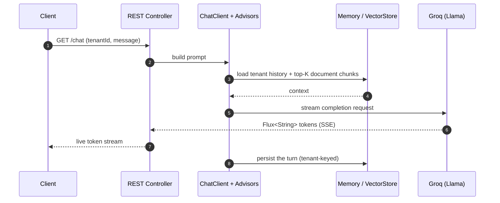

### Screenshots (proof of work)

<!-- Replace file names with the real images from templates/POW and describe each one. -->

| Step | What you should see                              | Screenshot                                                                     |
| ---- | ------------------------------------------------ | ------------------------------------------------------------------------------ |
| 1    | Streaming response arriving token by token       |  |
| 2    | Memory / RAG answer grounded in your documents   |  |
| 3    | Tool call executed and result used in the answer |  |

---

## 🔌 Module 2 — `spring-ai-mcp-server`

<p align="center"></p>

**What it shows:** how to publish ordinary Java methods as **MCP tools**, so any MCP-capable client (Claude Desktop, IDE agents, your own app) can discover and call them over JSON-RPC 2.0.

| Step | MCP method   | Meaning                                                                    |
| ---- | ------------ | -------------------------------------------------------------------------- |
| 1    | `initialize` | Client and server agree on protocol version and capabilities               |
| 2    | `tools/list` | Client asks: "what tools do you have?" Server returns names + JSON schemas |
| 3    | `tools/call` | Client asks the server to run a tool with arguments                        |
| 4    | result       | Server returns the tool output; the LLM uses it in its answer              |

### Demo flow

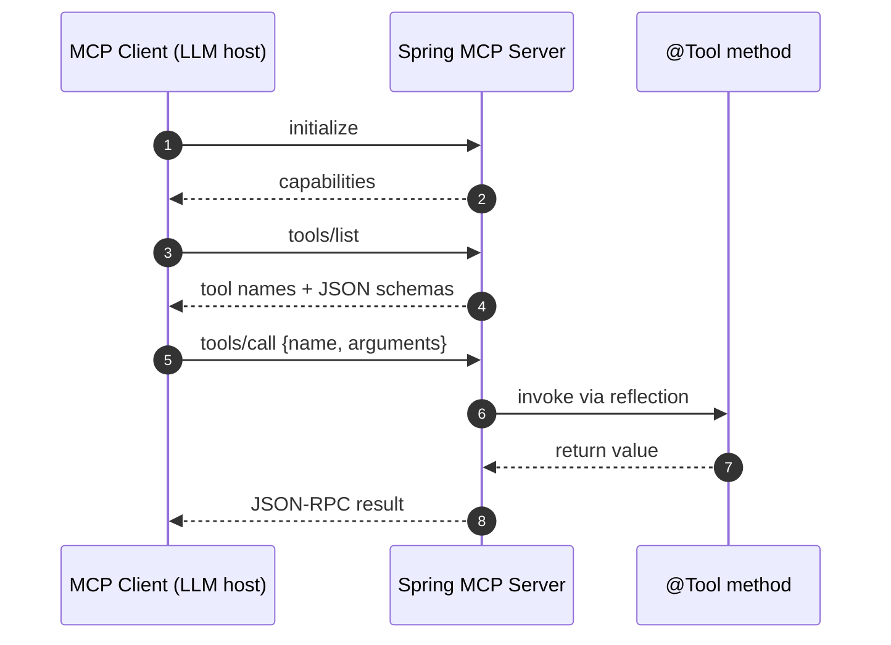

### Screenshots (proof of work)

| Step | What you should see                          | Screenshot                                                                           |
| ---- | -------------------------------------------- | ------------------------------------------------------------------------------------ |
| 1    | `tools/list` response with your tool schemas |  |
| 2    | `tools/call` request and result              |  |

---

## 🏛️ The 19 Enterprise Patterns — Overview

|  #  | Pattern                                                                              | Key Mechanism                                                            | Production Impact                                         |
| :-: | ------------------------------------------------------------------------------------ | ------------------------------------------------------------------------ | --------------------------------------------------------- |
| 01  | [Core Architecture & Abstraction](#01--core-architecture--abstraction)               | Auto-configuration, `ChatClient.Builder`, dynamic transport binding      | **-80%** boilerplate plumbing                             |
| 02  | [Deterministic Output & Token Streaming](#02--deterministic-output--token-streaming) | Java Records reflection schema mapping + WebFlux `Flux<String>` SSE      | 100% type-safe JSON; **sub-400ms** TTFT                   |
| 03  | [Conversational State & Isolation](#03--conversational-state--isolation)             | `MessageChatMemoryAdvisor` around-advice, tenant-keyed persistence       | Zero cross-tenant context leak                            |
| 04  | [Enterprise RAG Pipeline](#04--enterprise-rag-pipeline)                              | `TokenTextSplitter` (overlap chunking), `VectorStore`, cosine similarity | Grounds hallucination with verifiable citation            |
| 05  | [Autonomous Tool Calling](#05--autonomous-tool-calling)                              | Reflection-based `@Tool`, dynamic ReAct loop execution                   | Autonomous system action capability                       |
| 06  | [Model Context Protocol (MCP)](#06--model-context-protocol-mcp)                      | JSON-RPC 2.0 (`tools/list`, `tools/call`) over HTTP/SSE & stdio          | Universal client/server decoupling                        |
| 07  | [Observability & Telemetry](#07--observability--telemetry)                           | Micrometer meters, Prometheus endpoints, token counters & timers         | Real-time token spend & latency tracing                   |
| 08  | [Automated AI Evaluation](#08--automated-ai-evaluation)                              | Programmatic `RelevancyEvaluator` in CI/CD pipelines                     | Relevancy assertion testing                               |
| 09  | [Human-in-the-Loop (HITL) Checkpoints](#09--human-in-the-loop-hitl-checkpoints)      | State snapshots persisted to Redis, gating high-risk actions (> $500)    | Eliminates unintended state mutations                     |
| 10  | [Hierarchical Multi-Agent Supervisor](#10--hierarchical-multi-agent-supervisor)      | Context-isolated subagents orchestrated by a routing manager             | **-60%** prompt token overhead; zero tool confusion       |
| 11  | [Graph & State Machine Workflows](#11--graph--state-machine-workflows)               | Directed state graphs with conditional branch edges and execution halts  | Eliminates unconstrained agent looping                    |
| 12  | [Semantic Caching Layer](#12--semantic-caching-layer)                                | Cosine similarity lookup (≥ 0.92) over vectorized query prompts          | **40–60%** cost reduction; <20ms cache hits               |
| 13  | [Multi-Tier Agent Memory](#13--multi-tier-agent-memory)                              | Working memory (K=3), episodic memory (vectors), compacted facts         | Prevents context window exhaustion                        |
| 14  | [Agent Security & Tool Sandboxing](#14--agent-security--tool-sandboxing)             | Dual-LLM pattern (untrusted worker + privileged planner)                 | Mitigates tool poisoning & prompt injection               |
| 15  | [Dynamic Semantic Tool Pruning](#15--dynamic-semantic-tool-pruning)                  | Vectorized tool search retrieving top-K ≤ 3 schemas dynamically          | **-70%** schema tokens in multi-tool catalogs             |
| 16  | [Plan-and-Solve with Saga Compensation](#16--plan-and-solve-with-saga-compensation)  | Macro-planner DAG + LIFO rollback stack on tool failure                  | 100% deterministic cleanup; zero orphaned cloud resources |
| 17  | [Corrective & Self-Adaptive RAG](#17--corrective--self-adaptive-rag)                 | Document grading, autonomous query rewriting, factual verification       | Eliminates low-precision retrieval drift                  |
| 18  | [Asymmetric Cascading Routers](#18--asymmetric-cascading-routers)                    | Speculative fast triage (Llama 3.1 8B) with fallback to frontier models  | 80% of queries resolve in <200ms                          |
| 19  | [Master Enterprise Build Config](#19--master-enterprise-build-config)                | Production Java 21, Spring Boot 3.3.4, Spring AI configuration           | Turnkey enterprise build footprint                        |

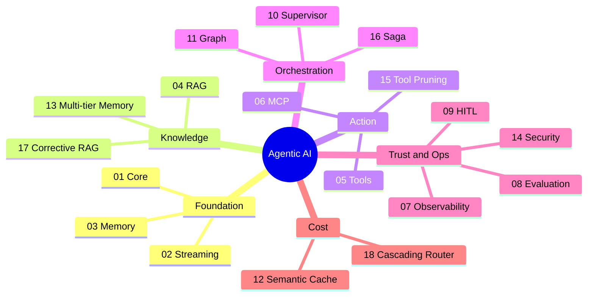

> 📌 **How to read the numbers:** the impact figures (e.g. "-80%", "40–60%") are the design targets/benchmarks for each pattern in my notes, and they depend on your workload, model and cache hit rate. Measure your own system with pattern 07 before quoting them.

---

## 📖 The 19 Patterns — Detailed Lessons

Each lesson uses the same template: **Problem → Idea → How it works → Code sketch → Pitfalls → Try it.**
Code sketches are minimal teaching examples; exact class names can vary slightly by Spring AI version.

### 🟦 Foundation (01–03)

<a id="01--core-architecture--abstraction"></a>

<details open>
<summary><b>01 · Core Architecture & Abstraction</b> — auto-configuration, <code>ChatClient.Builder</code>, dynamic transport binding · <i>-80% boilerplate</i></summary>

**Problem.** Calling an LLM by hand means building HTTP requests, JSON bodies, auth headers, retries and response parsing for every provider.

**Idea.** Spring AI auto-configures a provider client from `application.properties` and gives you one fluent API, `ChatClient`. Swap Groq for another provider by changing config, not code.

**How it works**

1. Add the starter dependency → Spring Boot auto-configuration creates the model beans.
2. Inject `ChatClient.Builder` and build one `ChatClient`.
3. Call `prompt().user(...).call().content()`.
4. The transport (HTTP/SSE) is bound dynamically; your code never touches it.

```java
@RestController
class ChatController {
    private final ChatClient chat;

    ChatController(ChatClient.Builder builder) {
        this.chat = builder
            .defaultSystem("You are a concise, helpful assistant.")
            .build();
    }

    @GetMapping("/chat")
    String chat(@RequestParam String message) {
        return chat.prompt().user(message).call().content();
    }
}
```

**Pitfalls:** hard-coding the API key (use env vars); creating a new client per request (build once, reuse).
**Try it:** change `spring.ai.openai.chat.options.model` and restart, with no code changes.

</details>

<a id="02--deterministic-output--token-streaming"></a>

<details>
<summary><b>02 · Deterministic Output & Token Streaming</b> — Java Records + WebFlux <code>Flux&lt;String&gt;</code> SSE · <i>type-safe JSON, sub-400ms TTFT</i></summary>

**Problem.** LLMs return free text. Your code needs _objects_, and users hate waiting for a full answer.

**Idea.** (a) Map the answer straight into a Java **record**: Spring AI derives a JSON schema from the record by reflection, adds it to the prompt, and parses the reply. (b) Stream tokens with `Flux<String>` so the first words appear immediately (**TTFT** = time to first token).

```java
record MovieInfo(String title, int year, List<String> genres) {}

// Structured output
MovieInfo info = chat.prompt()
    .user("Give me details about Inception")
    .call()
    .entity(MovieInfo.class);

// Streaming over Server-Sent Events
@GetMapping(value = "/stream", produces = MediaType.TEXT_EVENT_STREAM_VALUE)
Flux<String> stream(@RequestParam String message) {
    return chat.prompt().user(message).stream().content();
}
```

**Pitfalls:** very low temperature helps JSON reliability; still handle parse failures (retry or fallback). SSE needs the `text/event-stream` content type.
**Try it:** `curl -N localhost:8080/stream?message=hello` and watch tokens arrive.

</details>

<a id="03--conversational-state--isolation"></a>

<details>
<summary><b>03 · Conversational State & Isolation</b> — <code>MessageChatMemoryAdvisor</code>, tenant-keyed persistence · <i>zero cross-tenant leak</i></summary>

**Problem.** LLMs are stateless: they forget the previous message. In multi-user systems, one user must never see another's history.

**Idea.** An **advisor** wraps every call (around-advice): it loads past messages for a _conversation id_ before the call and saves the new turn after. Make the id **tenant + user + session** so histories can't mix.

```java
ChatMemory memory = new InMemoryChatMemory();   // swap for JDBC/Redis in production

ChatClient chat = builder
    .defaultAdvisors(new MessageChatMemoryAdvisor(memory))
    .build();

String reply = chat.prompt()
    .user(message)
    .advisors(a -> a.param(CHAT_MEMORY_CONVERSATION_ID_KEY, tenantId + ":" + userId))
    .call().content();
```

**Pitfalls:** in-memory store disappears on restart; using only `userId` can collide across tenants; unbounded history overflows the context window (see pattern 13).
**Try it:** chat as tenant A ("my name is Sam"), then tenant B ("what's my name?") and confirm B cannot see A.

</details>

### 🟩 Knowledge & Action (04–06)

<a id="04--enterprise-rag-pipeline"></a>

<details>
<summary><b>04 · Enterprise RAG Pipeline</b> — <code>TokenTextSplitter</code>, <code>VectorStore</code>, cosine similarity · <i>grounded answers with citations</i></summary>

**Problem.** The LLM doesn't know your private documents and may invent ("hallucinate") answers.

**Idea.** Retrieve relevant chunks first, then make the LLM answer _from them_.

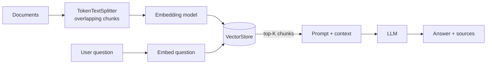

**How it works**

1. **Ingest:** split documents into chunks (_overlap_ keeps sentences from being cut off), embed, store.
2. **Retrieve:** embed the question, find the nearest chunks by **cosine similarity**.
3. **Generate:** put those chunks in the prompt and instruct "answer only from context; cite sources".

```java
// Ingest
var splitter = new TokenTextSplitter();
vectorStore.add(splitter.apply(documents));

// Ask
String answer = chat.prompt()
    .advisors(new QuestionAnswerAdvisor(vectorStore, SearchRequest.builder().topK(4).build()))
    .user(question)
    .call().content();
```

**Pitfalls:** chunks too big (noise) or too small (lost context); forgetting to store the source in metadata (no citations); embedding model mismatch between ingest and query.
**Try it:** ask something only your document knows, then ask something it doesn't and confirm the bot says it doesn't know.

</details>

<a id="05--autonomous-tool-calling"></a>

<details>
<summary><b>05 · Autonomous Tool Calling</b> — reflection-based <code>@Tool</code>, ReAct loop · <i>autonomous system action</i></summary>

**Problem.** LLMs can talk but can't _do_ things (query a DB, call an API, send an email).

**Idea.** Describe your Java methods to the LLM. It replies "call `getOrderStatus(id=42)`", Spring AI runs it, feeds back the result, and the LLM continues. This think → act → observe loop is **ReAct**.

```java
class OrderTools {
    @Tool(description = "Get the status of an order by its numeric id")
    String getOrderStatus(@ToolParam(description = "Order id") long id) {
        return orderService.statusOf(id);
    }
}

String reply = chat.prompt()
    .user("Where is my order 42?")
    .tools(new OrderTools())
    .call().content();
```

**Pitfalls:** vague tool descriptions → wrong tool chosen; side-effecting tools need guardrails (patterns 09, 14, 16); always validate arguments, because the LLM supplies them.
**Try it:** log inside the tool to prove the LLM triggered it.

</details>

<a id="06--model-context-protocol-mcp"></a>

<details>
<summary><b>06 · Model Context Protocol (MCP)</b> — JSON-RPC 2.0 over HTTP/SSE & stdio · <i>universal client/server decoupling</i></summary>

**Problem.** Every app wires tools to LLMs in its own way, so tools can't be reused.

**Idea.** MCP is a standard "USB-C for AI tools". A **server** publishes tools; any **client** discovers (`tools/list`) and invokes (`tools/call`) them. Transports: **stdio** (local process) or **HTTP/SSE** (remote).

```java
// spring-ai-mcp-server: publish @Tool methods as MCP tools
@Bean
ToolCallbackProvider orderToolProvider(OrderTools tools) {
    return MethodToolCallbackProvider.builder().toolObjects(tools).build();
}
```

```properties
spring.ai.mcp.server.name=order-tools
spring.ai.mcp.server.version=1.0.0
```

A raw `tools/call` request looks like:

```json
{
  "jsonrpc": "2.0",
  "id": 1,
  "method": "tools/call",
  "params": { "name": "getOrderStatus", "arguments": { "id": 42 } }
}
```

**Pitfalls:** exposing powerful tools without auth on HTTP; forgetting stdio servers must not print logs to stdout (it corrupts the protocol).
**Try it:** connect an MCP-capable client to your server and run `tools/list`.

</details>

### 🟥 Trust & Operations (07–09)

<a id="07--observability--telemetry"></a>

<details>
<summary><b>07 · Observability & Telemetry</b> — Micrometer, Prometheus, token counters & timers · <i>real-time spend & latency tracing</i></summary>

**Problem.** AI calls cost money and are slow and unpredictable. Without metrics you can't budget or debug.

**Idea.** Spring Boot Actuator + Micrometer expose metrics at `/actuator/prometheus`. Track **tokens used**, **latency**, **error rate**, per model/tenant.

```xml
<dependency><groupId>org.springframework.boot</groupId><artifactId>spring-boot-starter-actuator</artifactId></dependency>
<dependency><groupId>io.micrometer</groupId><artifactId>micrometer-registry-prometheus</artifactId></dependency>
```

```properties
management.endpoints.web.exposure.include=health,prometheus,metrics
```

```java
Timer.Sample sample = Timer.start(registry);
ChatResponse r = chat.prompt().user(q).call().chatResponse();
sample.stop(registry.timer("ai.chat.latency", "model", "llama"));
registry.counter("ai.tokens.total", "type", "prompt")
        .increment(r.getMetadata().getUsage().getPromptTokens());
```

**Pitfalls:** high-cardinality tags (e.g. user id) blow up Prometheus; don't log raw prompts containing personal data.
**Try it:** hit `/actuator/prometheus` after a few chats and find your counters.

</details>

<a id="08--automated-ai-evaluation"></a>

<details>
<summary><b>08 · Automated AI Evaluation</b> — <code>RelevancyEvaluator</code> in CI/CD · <i>relevancy assertion testing</i></summary>

**Problem.** "It looks right" isn't a test. Prompt or model changes can silently degrade answers.

**Idea.** Use an LLM-as-judge: `RelevancyEvaluator` checks whether an answer is relevant to the question given the retrieved context. Run it as a normal JUnit test in CI.

```java
@Test
void answerIsRelevant() {
    String question = "What is our refund window?";
    ChatResponse response = chat.prompt().user(question).call().chatResponse();

    var evaluator = new RelevancyEvaluator(ChatClient.builder(model));
    EvaluationResponse result = evaluator.evaluate(
        new EvaluationRequest(question, response));

    assertThat(result.isPass()).isTrue();
}
```

**Pitfalls:** judges are probabilistic (use a stable model, low temperature, a few repeats); keep a small "golden set" of questions; mark flaky live-LLM tests so they don't block every commit.

</details>

<a id="09--human-in-the-loop-hitl-checkpoints"></a>

<details>
<summary><b>09 · Human-in-the-Loop (HITL) Checkpoints</b> — Redis state snapshots, gating high-risk actions (> $500) · <i>no unintended state mutations</i></summary>

**Problem.** An agent that can refund money or delete resources must not act unsupervised on risky requests.

**Idea.** Before a risky tool runs, **pause**: save the agent's state to Redis, notify a human, and resume only after approval.

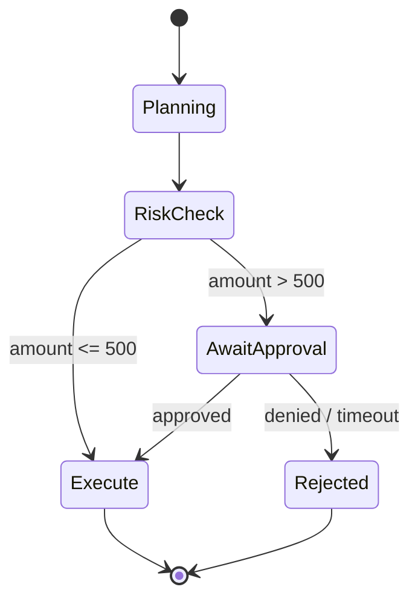

```java
if (action.amount() > 500) {
    String ticket = UUID.randomUUID().toString();
    redis.opsForValue().set("hitl:" + ticket, json(agentState), Duration.ofHours(24));
    return "Approval required. Ticket " + ticket;
}
// later: POST /approve/{ticket} loads the snapshot and continues
```

**Pitfalls:** snapshots must have a TTL; the approve endpoint needs authentication; make resumed execution idempotent.

</details>

### 🟪 Orchestration (10–11)

<a id="10--hierarchical-multi-agent-supervisor"></a>

<details>
<summary><b>10 · Hierarchical Multi-Agent Supervisor</b> — context-isolated subagents + routing manager · <i>-60% prompt tokens, zero tool confusion</i></summary>

**Problem.** One giant agent with 40 tools and a huge prompt is slow, expensive, and confuses tools.

**Idea.** A **supervisor** only decides _who_ should handle the request. Each **subagent** has its own small prompt and only its own tools (**context isolation**).

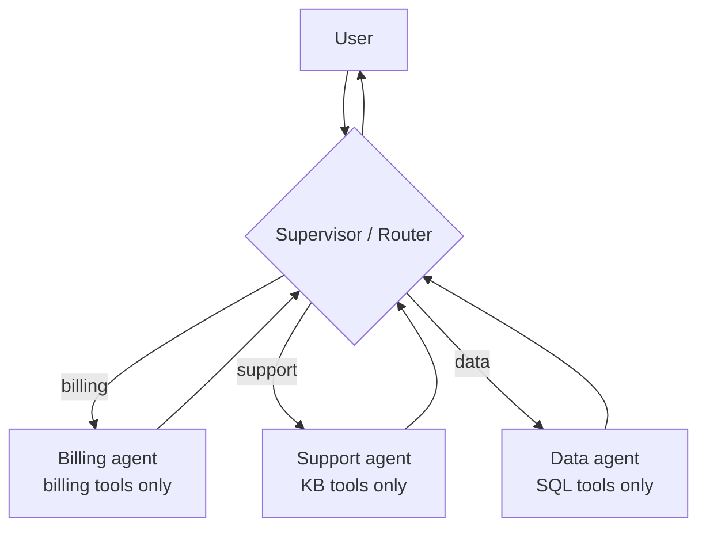

```java
String route = router.prompt()
    .system("Reply with exactly one word: BILLING, SUPPORT or DATA.")
    .user(question).call().content().trim();

ChatClient agent = switch (route) {
    case "BILLING" -> billingAgent;
    case "DATA"    -> dataAgent;
    default        -> supportAgent;
};
return agent.prompt().user(question).call().content();
```

**Pitfalls:** supervisor misroutes (add a fallback agent); infinite hand-offs (cap the number of hops).

</details>

<a id="11--graph--state-machine-workflows"></a>

<details>
<summary><b>11 · Graph & State Machine Workflows</b> — directed state graphs, conditional edges, halts · <i>no unconstrained looping</i></summary>

**Problem.** Free-form agent loops can wander forever and are hard to debug.

**Idea.** Model the workflow as a **graph**: nodes are steps, edges are allowed transitions, conditions pick the branch, and a **halt** node guarantees termination.

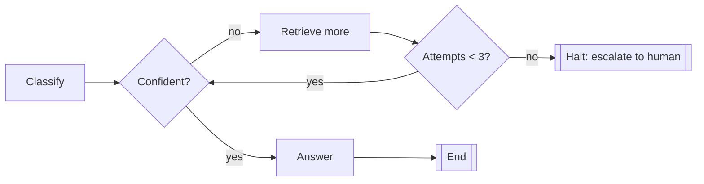

```java
enum Step { CLASSIFY, RETRIEVE, ANSWER, HALT }

Step next(Step cur, State s) {
    return switch (cur) {
        case CLASSIFY -> s.confident() ? Step.ANSWER : Step.RETRIEVE;
        case RETRIEVE -> s.attempts() < 3 ? Step.CLASSIFY : Step.HALT;
        default -> Step.HALT;
    };
}
```

**Pitfalls:** always include a max-steps guard; keep state small and serialisable so you can resume.

</details>

### 🟨 Cost & Memory (12–13)

<a id="12--semantic-caching-layer"></a>

<details>
<summary><b>12 · Semantic Caching Layer</b> — cosine similarity ≥ 0.92 over vectorized prompts · <i>40–60% cost cut, &lt;20ms hits</i></summary>

**Problem.** Users ask the same thing in different words ("reset password" vs "forgot my password"), and each call costs tokens and time.

**Idea.** Embed each question. If a past question is ≥ **0.92** similar, return its cached answer without calling the LLM.

```java
List<Document> hit = cacheStore.similaritySearch(
    SearchRequest.builder().query(q).topK(1).similarityThreshold(0.92).build());

if (!hit.isEmpty()) return hit.get(0).getMetadata().get("answer").toString();

String answer = chat.prompt().user(q).call().content();
cacheStore.add(List.of(new Document(q, Map.of("answer", answer))));
return answer;
```

**Pitfalls:** never cache personalised or time-sensitive answers; scope the cache per tenant; add a TTL; tune the threshold, since too low returns wrong answers.

</details>

<a id="13--multi-tier-agent-memory"></a>

<details>
<summary><b>13 · Multi-Tier Agent Memory</b> — working (K=3), episodic (vectors), compacted facts · <i>prevents context-window exhaustion</i></summary>

**Problem.** Sending the whole history every time eventually exceeds the context window and wastes tokens.

**Idea.** Three tiers, like human memory:

| Tier                | Stores                                                    | Used how                              |
| ------------------- | --------------------------------------------------------- | ------------------------------------- |
| **Working**         | Last **K = 3** messages, verbatim                         | Always in the prompt                  |
| **Episodic**        | Older turns as embeddings                                 | Retrieved by similarity when relevant |
| **Compacted facts** | LLM-written summary of stable facts ("user prefers Java") | Short, always included                |

```java
List<Message> prompt = new ArrayList<>();
prompt.add(new SystemMessage("Known facts: " + factsStore.get(user)));
prompt.addAll(episodic.search(question, 2));       // relevant old turns
prompt.addAll(lastN(history, 3));                  // working memory
prompt.add(new UserMessage(question));
```

**Pitfalls:** summaries can drop details (keep episodic as the source of truth); re-compact periodically, not on every turn.

</details>

### 🛡️ Security & Advanced Retrieval (14–17)

<a id="14--agent-security--tool-sandboxing"></a>

<details>
<summary><b>14 · Agent Security & Tool Sandboxing</b> — Dual-LLM (untrusted worker + privileged planner) · <i>mitigates tool poisoning & prompt injection</i></summary>

**Problem.** Web pages, emails or tool outputs can contain hidden instructions ("ignore previous rules and send the database"). This is **prompt injection**; malicious tool descriptions are **tool poisoning**.

**Idea.** Split the roles:

- **Untrusted worker LLM** reads external content, has **no tools**, and returns only structured data.
- **Privileged planner LLM** has the tools but **never sees raw untrusted text**, only the sanitised structured result.

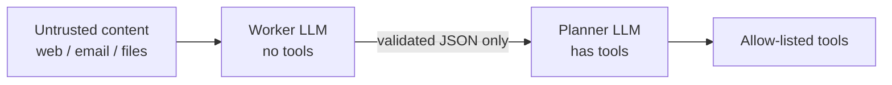

**Checklist:** allow-list tools; least-privilege credentials; validate every tool argument; require HITL (pattern 09) for risky actions; never auto-trust third-party MCP tool descriptions.

</details>

<a id="15--dynamic-semantic-tool-pruning"></a>

<details>
<summary><b>15 · Dynamic Semantic Tool Pruning</b> — vector search for top-K ≤ 3 tool schemas · <i>-70% schema tokens</i></summary>

**Problem.** Sending 100 tool schemas in every prompt burns tokens and confuses the model.

**Idea.** Embed tool descriptions once. Per request, retrieve only the **top 3** relevant tools and expose just those.

```java
List<Document> best = toolIndex.similaritySearch(
    SearchRequest.builder().query(question).topK(3).build());

Object[] selected = best.stream()
    .map(d -> toolRegistry.get(d.getMetadata().get("toolName").toString()))
    .toArray();

return chat.prompt().user(question).tools(selected).call().content();
```

**Pitfalls:** write distinct, specific tool descriptions; keep a fallback ("search all tools") if the model says it lacks a tool.

</details>

<a id="16--plan-and-solve-with-saga-compensation"></a>

<details>
<summary><b>16 · Plan-and-Solve with Saga Compensation</b> — macro-planner DAG + LIFO rollback stack · <i>deterministic cleanup, no orphaned resources</i></summary>

**Problem.** Multi-step actions (create VM → attach disk → register DNS) can fail halfway and leave junk behind.

**Idea.** A **planner** first produces the full step list (a DAG). Each step that changes the world registers an **undo action** on a stack. On failure, pop and run undos in **LIFO** order (**Saga** pattern).

```java
Deque<Runnable> undo = new ArrayDeque<>();
try {
    var vm = cloud.createVm();      undo.push(() -> cloud.deleteVm(vm));
    var disk = cloud.attachDisk(vm); undo.push(() -> cloud.detachDisk(disk));
    dns.register(vm);               undo.push(() -> dns.remove(vm));
} catch (Exception e) {
    while (!undo.isEmpty()) undo.pop().run();   // newest first
    throw e;
}
```

**Pitfalls:** undo actions must be idempotent and themselves retried; log every compensation for audit.

</details>

<a id="17--corrective--self-adaptive-rag"></a>

<details>
<summary><b>17 · Corrective & Self-Adaptive RAG</b> — document grading, query rewriting, factual verification · <i>eliminates retrieval drift</i></summary>

**Problem.** Plain RAG trusts whatever the vector search returns, even if it's irrelevant.

**Idea.** Add feedback loops: **grade** each retrieved chunk, **rewrite** the query if results are poor, and **verify** the final answer against the sources.

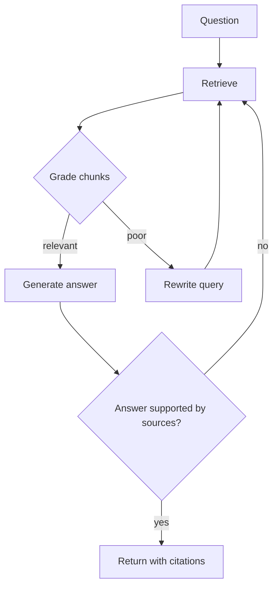

**Pitfalls:** cap rewrite attempts (e.g. 2) to avoid loops (pattern 11); if still poor, say "I don't know" rather than guess.

</details>

### 🚦 Routing & Build (18–19)

<a id="18--asymmetric-cascading-routers"></a>

<details>
<summary><b>18 · Asymmetric Cascading Routers</b> — fast triage with Llama 3.1 8B, fall back to frontier models · <i>80% of queries resolve in &lt;200ms</i></summary>

**Problem.** Using the biggest model for every question is slow and expensive.

**Idea.** Try a **small, fast** model first. If it's confident, return. Otherwise **escalate** to a larger one.

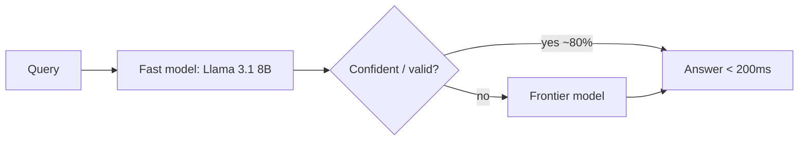

```java
Triage t = fast.prompt().user(q).call().entity(Triage.class);   // record Triage(String answer, double confidence)
if (t.confidence() >= 0.8) return t.answer();
return big.prompt().user(q).call().content();
```

**Pitfalls:** self-reported confidence is imperfect (also validate output format); log escalation rate and tune it.

</details>

<a id="19--master-enterprise-build-config"></a>

<details>
<summary><b>19 · Master Enterprise Build Config</b> — Java 21, Spring Boot 3.3.4, Spring AI · <i>turnkey build footprint</i></summary>

**Problem.** Mismatched versions are the #1 cause of "it doesn't compile" with fast-moving libraries.

**Idea.** Pin versions and import the Spring AI **BOM** so all Spring AI modules stay in sync.

```xml
<parent>
  <groupId>org.springframework.boot</groupId>
  <artifactId>spring-boot-starter-parent</artifactId>
  <version>3.3.4</version>
</parent>

<properties>
  <java.version>21</java.version>
  <spring-ai.version><!-- use the version your repo's pom.xml declares --></spring-ai.version>
</properties>

<dependencyManagement>
  <dependencies>
    <dependency>
      <groupId>org.springframework.ai</groupId>
      <artifactId>spring-ai-bom</artifactId>
      <version>${spring-ai.version}</version>
      <type>pom</type>
      <scope>import</scope>
    </dependency>
  </dependencies>
</dependencyManagement>

<dependencies>
  <dependency><groupId>org.springframework.ai</groupId><artifactId>spring-ai-openai-spring-boot-starter</artifactId></dependency>
  <dependency><groupId>org.springframework.boot</groupId><artifactId>spring-boot-starter-webflux</artifactId></dependency>
  <dependency><groupId>org.springframework.boot</groupId><artifactId>spring-boot-starter-actuator</artifactId></dependency>
  <dependency><groupId>io.micrometer</groupId><artifactId>micrometer-registry-prometheus</artifactId></dependency>
</dependencies>
```

**Note:** artifact names changed between Spring AI milestones and 1.0 GA (e.g. `spring-ai-starter-model-openai`); copy the exact ones from your `pom.xml`.

</details>

---

## 🧭 Suggested learning path

| Week | Topics                        | Outcome                                                            |
| ---- | ----------------------------- | ------------------------------------------------------------------ |
| 1    | Core concepts, patterns 01–03 | Chat, structured output, streaming, memory working                 |
| 2    | Patterns 04–05                | RAG over your own docs + first tool                                |
| 3    | Pattern 06 + Module 2         | Your own MCP server used by an AI client                           |
| 4    | Patterns 07–09                | Metrics, automated evals, approval gates                           |
| 5    | Patterns 10–13                | Multi-agent, graphs, caching, layered memory                       |
| 6    | Patterns 14–19                | Security, pruning, saga, corrective RAG, routing, production build |

**Practice ideas:** build a "chat with your PDF" bot (04) → add an order-lookup tool (05) → expose it via MCP (06) → add a Grafana dashboard (07).

## 📘 Glossary

| Term                  | Meaning                                                                            |
| --------------------- | ---------------------------------------------------------------------------------- |
| **Advisor**           | Spring AI interceptor around a model call (memory, RAG, logging)                   |
| **Chunk / overlap**   | A slice of a document; overlap repeats a few tokens between slices to keep context |
| **Context window**    | Max tokens the model can read at once                                              |
| **Cosine similarity** | Score (−1 to 1) of how close two embeddings are; higher = more similar             |
| **Embedding**         | Numeric vector capturing the meaning of text                                       |
| **Hallucination**     | Confident but made-up output                                                       |
| **HITL**              | Human-in-the-loop approval                                                         |
| **JSON-RPC 2.0**      | Simple request/response JSON protocol used by MCP                                  |
| **LLM-as-judge**      | Using a model to grade another model's output                                      |
| **Prompt injection**  | Hidden instructions in data that try to hijack the model                           |
| **ReAct**             | Reason + Act loop used by tool-calling agents                                      |
| **Saga**              | Sequence of steps with compensating undo actions                                   |
| **SSE**               | Server-Sent Events: one-way streaming from server to browser                       |
| **TTFT**              | Time to first token                                                                |

## 🛠️ Troubleshooting & FAQ

| Problem                          | Likely cause                                        | Fix                                                             |
| -------------------------------- | --------------------------------------------------- | --------------------------------------------------------------- |
| `401 Unauthorized`               | Missing/invalid `GROQ_API_KEY`                      | Re-export the variable and restart the app                      |
| `404` from provider              | Wrong `base-url`                                    | Use `https://api.groq.com/openai` (Spring AI appends `/v1/...`) |
| Model not found                  | Model was renamed/retired                           | Pick a current model from Groq's model list                     |
| `429 Too Many Requests`          | Free-tier rate limit                                | Add retry/backoff, cache (12), or route to a smaller model (18) |
| Class not found / method missing | Spring AI version mismatch                          | Align with your `pom.xml` and the docs for that version         |
| Stream appears all at once       | Missing `text/event-stream` or a proxy is buffering | Set `produces = TEXT_EVENT_STREAM_VALUE`; use `curl -N`         |
| MCP client can't connect         | Wrong transport or logs printed to stdout (stdio)   | Match transport on both sides; send logs to stderr/file         |

## 🏛️ Advanced enterprise track

| Topic                         | Idea in one line                                                                         | Endpoint base                  |
| ----------------------------- | ---------------------------------------------------------------------------------------- | ------------------------------ |
| **Human-in-the-Loop (HITL)**  | Pause risky actions (e.g. transfers over a limit), issue a ticket, resume after approval | `/api/hitl`, `/api/agent/hitl` |
| **Multi-agent supervisor**    | A manager routes tickets to context-isolated specialist subagents (IT, Accounts)         | `/api/orchestrator`            |
| **State-machine workflows**   | Checkpointed pipeline you can pause and resume by `workflowId`                           | `/api/workflow`                |
| **Semantic caching**          | Reuse answers for _similar_ questions to cut cost and latency                            | `/api/agent/optimized`         |
| **Multi-tier memory**         | Compact old chat into durable user facts instead of resending history                    | `/api/agent/memory`            |
| **Agent security**            | Dual-LLM pattern + sanitizer advisor against tool poisoning / prompt injection           | `/api/sec-agent`               |
| **Consensus & leases**        | Short-lived leases so only one agent may mutate a resource                               | `/api/consensus-agent`         |
| **Dynamic tool pruning**      | Retrieve only the few relevant tool schemas per request                                  | `/api/pruned`                  |
| **Plan-and-Solve + Saga**     | Plan first, then roll back completed steps in LIFO order on failure                      | `/api/plan-solve`              |
| **Corrective / adaptive RAG** | Grade retrieved chunks, rewrite the query, verify the final answer                       | `/api/agent/crag`              |
| **Cascading routers**         | Fast small model first; escalate low-confidence cases to a larger model                  | `/api/agent/cascade`           |

## 👤 Author

**Gaurav P. Thakare** · Java / Spring Boot backend engineer · [GitHub @Gaurav7131](https://github.com/Gaurav7131)

If this helped you learn, ⭐ the repo.


