<div align="center">



**A visual architecture reference, engineering guide and implementation handbook for resilient, stateful, autonomous AI microservices on the JVM.**

</div>

> [!TIP]
> **How to read this README.** The five animated diagrams (glowing packets = data flowing through the system) are SVGs and loop automatically. Every other diagram is Mermaid and renders natively on GitHub. Follow the arrows, then read the notes under each diagram.

---

## 📑 Table of Contents

| # | Topic | # | Topic |
|---|-------|---|-------|
| 1 | [Core Architecture & Spring AI Abstraction](#1-core-architecture--spring-ai-abstraction) | 11 | [State-Machine & Graph Workflows](#11-state-machine--graph-based-workflows) |
| 2 | [Deterministic Outputs & Token Streaming](#2-deterministic-outputs--token-streaming) | 12 | [Semantic Caching & Cost Optimization](#12-semantic-caching--token-cost-optimization) |
| 3 | [Conversational State & Prompt Guardrails](#3-conversational-state--prompt-guardrails) | 13 | [Multi-Tier Memory & Fact Compaction](#13-multi-tier-agent-memory--fact-compaction) |
| 4 | [Enterprise RAG](#4-enterprise-rag-retrieval-augmented-generation) | 14 | [Agentic Security & Injection Defense](#14-agentic-security-injection-defense--tool-sandboxing) |
| 5 | [Tool Calling & ReAct Loops](#5-autonomous-tool-calling--react-loops) | 15 | [Dynamic Semantic Tool Pruning](#15-dynamic-semantic-tool-pruning) |
| 6 | [Model Context Protocol (MCP)](#6-model-context-protocol-mcp-integration) | 16 | [Plan-and-Solve with Saga Compensation](#16-plan-and-solve-with-saga-compensation) |
| 7 | [Observability & Metrics](#7-observability--metrics-instrumentation) | 17 | [Corrective & Self-Adaptive RAG](#17-corrective--self-adaptive-rag-self-rag) |
| 8 | [Automated AI Evaluation & CI/CD](#8-automated-ai-evaluation--cicd-verification) | 18 | [Cascading Routers & Speculative Fallback](#18-asymmetric-cascading-routers--speculative-fallback) |
| 9 | [Human-in-the-Loop & Saga Checkpointing](#9-human-in-the-loop-hitl-guardrails--saga-checkpointing) | 19 | [Master Build Configuration](#19-master-build-configuration-pomxml--properties) |
| 10 | [Hierarchical Multi-Agent Supervisor](#10-hierarchical-multi-agent-supervisor-pattern) | | |

---

## 🗺️ The Big Picture

```mermaid
flowchart LR
    subgraph Client
        U[REST / SSE / MCP host]
    end
    subgraph "Spring Boot Microservice"
        R[Router & Semantic Cache] --> S[Supervisor]
        S --> A1[Subagent: IT Triage]
        S --> A2[Subagent: Accounts]
        A1 & A2 --> T[@Tool beans]
        S --> RAG[RAG Advisor]
        RAG --> VS[(Vector Store)]
        S --> M[(Tiered Memory)]
        T --> H{HITL gate}
    end
    subgraph Inference
        F[Fast tier: Llama 3.1 8B / Groq]
        P[Frontier tier]
    end
    U --> R
    S --> F
    F -. escalate .-> P
    H -->|approved| BE[(Backend systems)]
```

---

## 1. Core Architecture & Spring AI Abstraction

Spring AI does for generative AI what Spring Data / `JdbcTemplate` did for databases: **your business logic never touches a vendor wire format.**

| Layer | Type | Role |
|-------|------|------|
| Low-level SPI | `ChatModel`, `EmbeddingModel` | Converts Java objects ⇄ provider-specific HTTP payloads |
| High-level fluent API | `ChatClient` | `chatClient.prompt().user(...).call().content()` — same feel as `RestClient` / `WebClient` |

| Runtime | How | Trade-off |
|---------|-----|-----------|
| ☁️ **Groq LPU** | OpenAI wire format → `spring.ai.openai.base-url=https://api.groq.com/openai` | No local weights, sub-second generation |
| 🏠 **Ollama** | `http://localhost:11434` | Data stays on your network, no API cost, bound by local RAM/GPU |

### ▶️ Auto-configuration pipeline


---

## 2. Deterministic Outputs & Token Streaming

LLMs emit probabilistic text; downstream services need contracts. Spring AI reflects over a Java **record**, builds a JSON Schema, injects it into the prompt, and deserializes the answer with `.entity(...)`.

```java
public record CodeReview(
    String summary,
    int qualityScore,
    List<String> keyRisks,
    List<String> recommendations
) {}

CodeReview review = chatClient.prompt()
        .user("Review this diff: {diff}")   // illustrative
        .call()
        .entity(CodeReview.class);
```

**Streaming over SSE** replaces a multi-second blocking wait with token-by-token delivery (chunked `text/event-stream`), bringing Time-to-First-Token to the ~300–400 ms range.

```java
@GetMapping(value = "/stream", produces = MediaType.TEXT_EVENT_STREAM_VALUE)
public Flux<String> stream(@RequestParam String q) {
    return chatClient.prompt().user(q).stream().content();
}
```

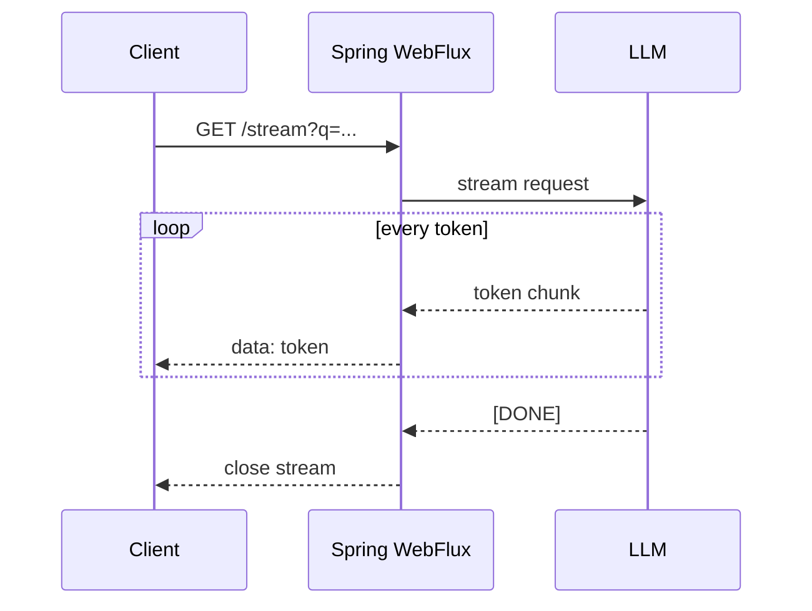

---

## 3. Conversational State & Prompt Guardrails

**Prompt isolation.** `.defaultSystem(...)` holds non-negotiable rules (role, security, off-topic refusal). `.user(...)` carries only dynamic input. Use named placeholders (`{query}`, `{tier}`) with `.param(...)` — never string concatenation.

**Stateful chat on a stateless API.** `MessageChatMemoryAdvisor` is an AOP *around-advice*:

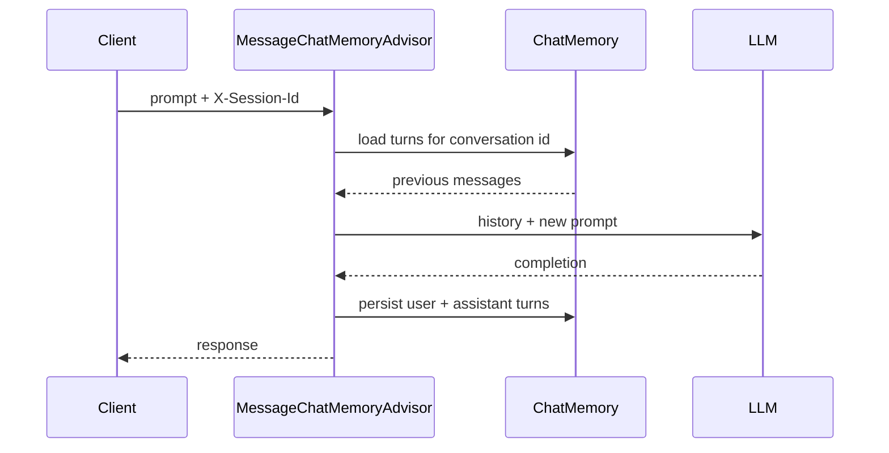

> 🔒 **Tenant isolation:** independent session keys guarantee no cross-session leakage between concurrent tenants.

---

## 4. Enterprise RAG (Retrieval-Augmented Generation)

RAG is an **open-book exam**: the model answers from your private documents instead of from stale training data.

### ▶️ Ingestion + query pipeline


| Building block | Purpose |
|----------------|---------|
| `TikaDocumentReader` / `TextReader` | Extract PDF, DOCX, TXT into `Document` objects |
| `TokenTextSplitter` | ~200–800 token windows; **overlap** keeps clauses from being cut in half |
| Embedding model | Text → semantic vectors (distinct from the *generation* model) |
| `SimpleVectorStore` | In-memory cosine-similarity index |
| `QuestionAnswerAdvisor` | Intercepts the prompt, retrieves chunks, injects context, enforces *"if absent in context, decline"* |
| Offline `AbstractEmbeddingModel` fallback | Deterministic local vectors when ONNX weights / remote embeddings are blocked by a firewall |

```java
ChatClient rag = builder
    .defaultAdvisors(new QuestionAnswerAdvisor(vectorStore))   // illustrative
    .build();
```

---

## 5. Autonomous Tool Calling & ReAct Loops

Generative AI produces text; **agentic AI reasons and acts.** Annotate bean methods with `@Tool` / `@ToolParam`; Spring AI publishes them as JSON schemas and runs the call/observe loop for you.

### ▶️ The ReAct loop


```java
@Service
public class OrderTools {
    @Tool(description = "Look up the status of an order by id")
    public String orderStatus(@ToolParam(description = "Order id") String orderId) { ... }
}
```

> [!WARNING]
> Unrestricted tools invite unauthorized mutation and prompt-injection hijacking. Use `@Valid` parameter validation, RBAC, **read-only defaults**, and HITL circuit breakers on destructive tools (see §9).

---

## 6. Model Context Protocol (MCP) Integration

MCP is the "USB-C for AI tools": expose your `@Tool` beans **once** over JSON-RPC 2.0 and any MCP host (Claude Desktop, Cursor, other agents) can use them.

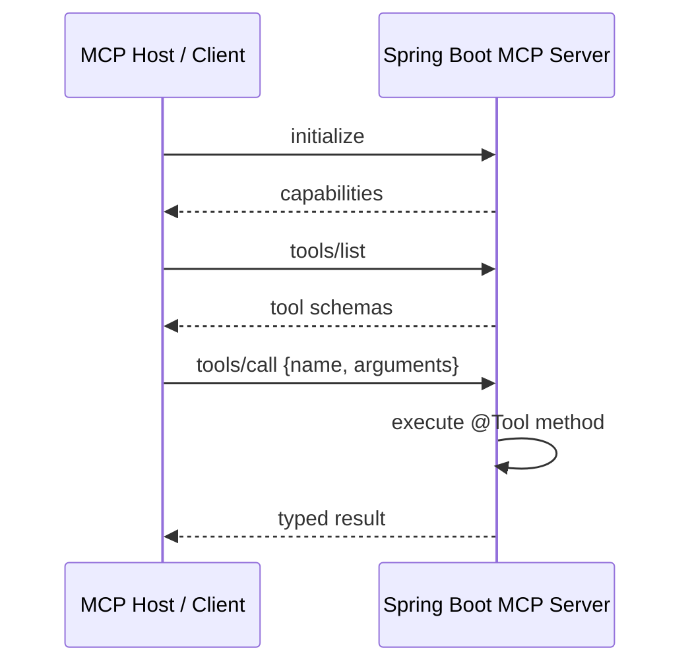

| Transport | Use it for | Gotcha |
|-----------|-----------|--------|
| `stdio` | Local desktop apps | Set `spring.main.banner-mode=off` and disable console logging, or the JSON-RPC stream breaks |
| `SSE` / `STREAMABLE` | Remote / containerized servers | Needs reachable HTTP endpoints (`/mcp/sse`, `/mcp/message`) |

---

## 7. Observability & Metrics Instrumentation

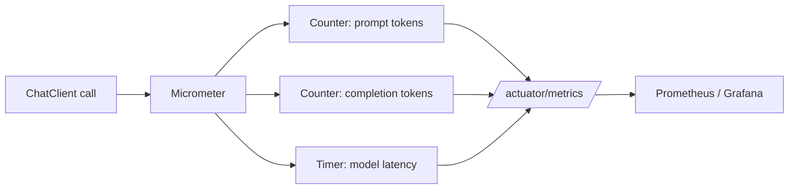

Track **token consumption, throughput and latency** via Actuator + Micrometer. The same instrumentation validates local Ollama runs before you promote to cloud inference.

---

## 8. Automated AI Evaluation & CI/CD Verification

Don't assert exact strings against probabilistic output — **evaluate** it.

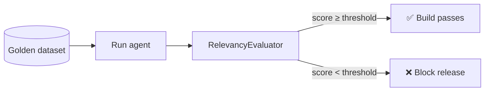

`RelevancyEvaluator` checks that a completion actually answers the query without off-topic hallucination. Run the suite in CI to catch **model degradation and prompt regressions** before production.

---

## 9. Human-in-the-Loop (HITL) Guardrails & Saga Checkpointing

Escape the *autonomous-agency trap*: high-risk actions **pause**, **persist**, and **resume** only after an authorized human approves.

### ▶️ Approval workflow with rollback


1. **Threshold gating** — e.g. transaction > $500 or server decommissioning pauses execution.
2. **State checkpointing** — an immutable `WorkflowState` snapshot is saved (Redis/PostgreSQL) and a ticket returns `APPROVAL_PENDING`.
3. **Async resumption** — an operator calls `/approve` (or `/resume`); the orchestrator reloads state and completes the mutation.

---

## 10. Hierarchical Multi-Agent Supervisor Pattern

Dozens of `@Tool` methods in one prompt cause context bloat, p99 spikes and wrong tool picks. **Decompose.**

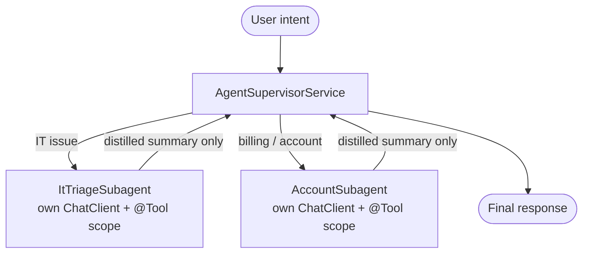

**Context boundary:** each subagent's reasoning loop and error traces stay inside its own context; only a short summary returns, minimizing token overhead.

---

## 11. State-Machine & Graph-Based Workflows

Replace open-ended ReAct loops with a **directed graph**: nodes = discrete tasks, edges = conditional transitions.

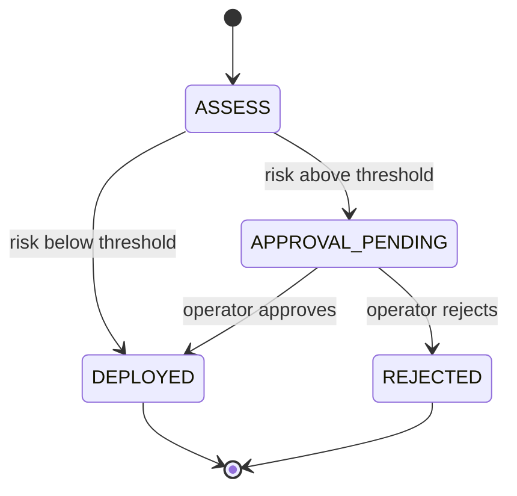

Execution is predictable, pauses at mutation nodes with a written snapshot, and resumes on operator input.

---

## 12. Semantic Caching & Token Cost Optimization

String-keyed caches fail on natural language ("reset my password" ≠ "how do I change my password"). Cache by **meaning**.

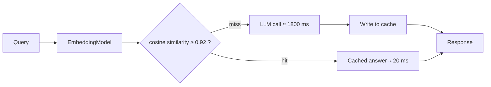

| Metric | Effect |
|--------|--------|
| p99 latency | ~1800 ms → < 20 ms on hits |
| Token spend | ~40–60 % reduction |

> [!IMPORTANT]
> Cache **idempotent reads only.** Never let the semantic cache intercept state-altering tool calls.

---

## 13. Multi-Tier Agent Memory & Fact Compaction

Blindly replaying history causes token exhaustion and "lost-in-the-middle" errors.

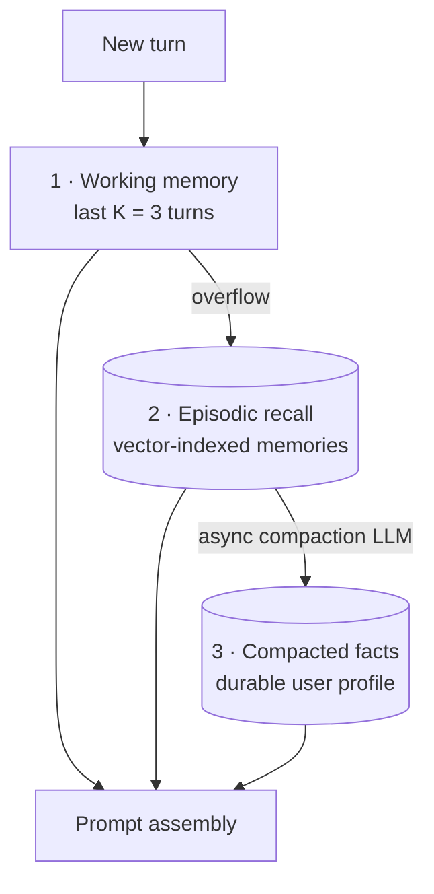

A background LLM distills durable entities (preferred regions, language targets…) into key-value profiles and prunes conversational fluff, keeping prompts bounded.

---

## 14. Agentic Security, Injection Defense & Tool Sandboxing

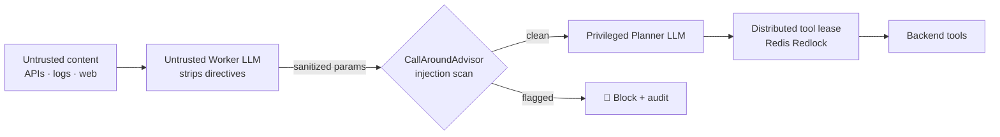

* **Indirect tool poisoning** — hostile text inside fetched content tries to hijack the agent.
* **Dual-LLM split** — the *untrusted worker* touches raw input; the *privileged planner* only ever sees sanitized parameters.
* **Advisor sanitization** — inspect prompts **and** completions for injection patterns before any tool runs.
* **Tool leases** — acquire a distributed lock before mutating, eliminating split-brain updates across replicas.

---

## 15. Dynamic Semantic Tool Pruning

With 50+ tools, serializing every schema wastes context and hurts selection accuracy.

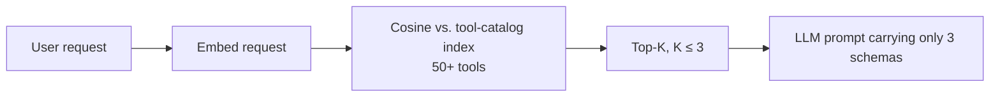

**Result:** > 70 % less prompt overhead and far fewer cross-domain tool mix-ups.

---

## 16. Plan-and-Solve with Saga Compensation

ReAct is myopic. **Plan first** (a typed DAG via structured output), execute with a stack, and **roll back in reverse** on failure.

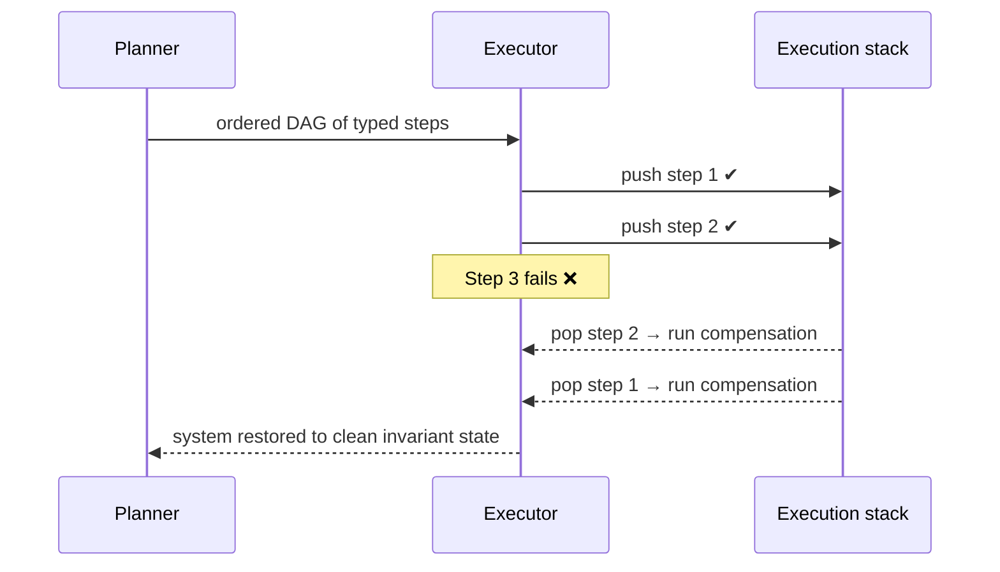

Examples of compensations: deallocate the subnet that was allocated, refund the balance that was charged.

---

## 17. Corrective & Self-Adaptive RAG (Self-RAG)

Standard RAG is linear and passive — noisy retrieval means confident hallucination. Close the loop:

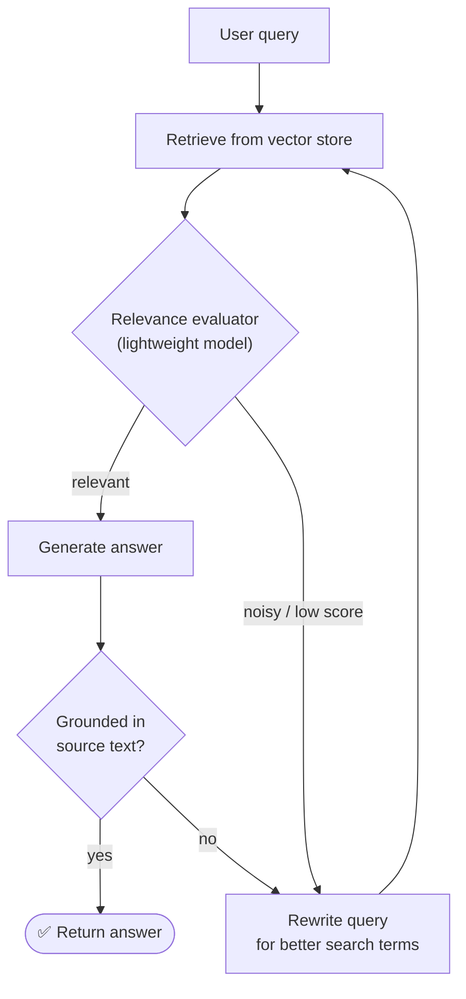

---

## 18. Asymmetric Cascading Routers & Speculative Fallback

Solve the **latency–cost–reliability trilemma**: be fast by default, smart on demand.

### ▶️ Cascade in action (green = fast path, orange = escalation)


| Tier | Model example | Behavior |
|------|---------------|----------|
| ⚡ Fast (speculative) | Llama-3.1-8B on Groq | Receives 100 % of routine traffic |
| 🛡️ Validation barrier | JSON-schema + business rules + τ ≥ 0.85 | Deterministic gate |
| 🧠 Frontier | GPT-4o / Claude | Only on validation failure or low confidence |

**Outcome:** ~80 % of traffic resolved in under 200 ms, with frontier accuracy preserved for edge cases.

---

## 19. Master Build Configuration (`pom.xml` & Properties)

### 🚀 Quick start

```bash
export GROQ_API_KEY=<your-key>
./mvnw spring-boot:run
# server on http://localhost:8081
curl http://localhost:8081/actuator/health
```

> [!NOTE]
> **Version compatibility.** The reference build pins Spring AI `1.0.0-M3`. Several features described here — the `@Tool` / `@ToolParam` annotations, the MCP server starters, and the `spring-ai-advisors-vector-store` module — shipped in later milestones / the `1.0.x` line, and artifact names changed at GA (e.g. `spring-ai-starter-model-openai`, as referenced in §1). If a dependency fails to resolve or an annotation is missing, bump `spring-ai.version` (and Spring Boot) to a release that includes it and use the matching starter names from the Spring AI docs.

<details>
<summary><b>📦 pom.xml</b> (click to expand)</summary>

```xml
<?xml version="1.0" encoding="UTF-8"?>
<project xmlns="http://maven.apache.org/POM/4.0.0"
         xmlns:xsi="http://www.w3.org/2001/XMLSchema-instance"
         xsi:schemaLocation="http://maven.apache.org/POM/4.0.0 https://maven.apache.org/xsd/maven-4.0.0.xsd">
    <modelVersion>4.0.0</modelVersion>

    <parent>
        <groupId>org.springframework.boot</groupId>
        <artifactId>spring-boot-starter-parent</artifactId>
        <version>3.3.4</version>
        <relativePath/>
    </parent>

    <groupId>com.example</groupId>
    <artifactId>enterprise-agentic-ai</artifactId>
    <version>0.0.1-SNAPSHOT</version>
    <name>enterprise-agentic-ai</name>

    <properties>
        <java.version>21</java.version>
        <spring-ai.version>1.0.0-M3</spring-ai.version>
    </properties>

    <dependencies>
        <!-- Web & Reactive Streaming -->
        <dependency>
            <groupId>org.springframework.boot</groupId>
            <artifactId>spring-boot-starter-web</artifactId>
        </dependency>
        <dependency>
            <groupId>org.springframework.boot</groupId>
            <artifactId>spring-boot-starter-webflux</artifactId>
        </dependency>

        <!-- Observability & Telemetry -->
        <dependency>
            <groupId>org.springframework.boot</groupId>
            <artifactId>spring-boot-starter-actuator</artifactId>
        </dependency>
        <dependency>
            <groupId>io.micrometer</groupId>
            <artifactId>micrometer-core</artifactId>
        </dependency>

        <!-- Spring AI Starters (OpenAI wire format compatible with Groq) -->
        <dependency>
            <groupId>org.springframework.ai</groupId>
            <artifactId>spring-ai-openai-spring-boot-starter</artifactId>
        </dependency>

        <!-- RAG Ingestion & Vector Storage -->
        <dependency>
            <groupId>org.springframework.ai</groupId>
            <artifactId>spring-ai-tika-document-reader</artifactId>
        </dependency>
        <dependency>
            <groupId>org.springframework.ai</groupId>
            <artifactId>spring-ai-advisors-vector-store</artifactId>
        </dependency>

        <!-- In-Process Transformers Local Embedding Engine -->
        <dependency>
            <groupId>org.springframework.ai</groupId>
            <artifactId>spring-ai-transformers-embedding-spring-boot-starter</artifactId>
        </dependency>

        <dependency>
            <groupId>org.springframework.boot</groupId>
            <artifactId>spring-boot-starter-test</artifactId>
            <scope>test</scope>
        </dependency>
    </dependencies>

    <dependencyManagement>
        <dependencies>
            <dependency>
                <groupId>org.springframework.ai</groupId>
                <artifactId>spring-ai-bom</artifactId>
                <version>${spring-ai.version}</version>
                <type>pom</type>
                <scope>import</scope>
            </dependency>
        </dependencies>
    </dependencyManagement>

    <build>
        <plugins>
            <plugin>
                <groupId>org.springframework.boot</groupId>
                <artifactId>spring-boot-maven-plugin</artifactId>
            </plugin>
        </plugins>
    </build>

    <repositories>
        <repository>
            <id>spring-milestones</id>
            <name>Spring Milestones</name>
            <url>https://repo.spring.io/milestone</url>
            <snapshots>
                <enabled>false</enabled>
            </snapshots>
        </repository>
    </repositories>
</project>
```

</details>

<details>
<summary><b>⚙️ src/main/resources/application.properties</b> (click to expand)</summary>

```properties
server.port=8081
spring.application.name=enterprise-agentic-ai

# Groq Cloud Inference Configuration (OpenAI-Compatible Wire Format)
spring.ai.openai.api-key=${GROQ_API_KEY}
spring.ai.openai.base-url=https://api.groq.com/openai
spring.ai.openai.chat.options.model=llama-3.1-8b-instant
spring.ai.openai.chat.options.temperature=0.0

# Disable Remote OpenAI Embeddings to Enforce In-Process Local Embeddings
spring.ai.openai.embedding.enabled=false

# Actuator & Observability Endpoints
management.endpoints.web.exposure.include=health,info,metrics
management.endpoint.metrics.enabled=true
management.metrics.tags.application=${spring.application.name}

# Model Context Protocol (MCP) Configuration
spring.ai.mcp.server.name=enterprise-operations-server
spring.ai.mcp.server.version=1.0.0
spring.ai.mcp.server.protocol=STREAMABLE
spring.ai.mcp.server.sse.message-endpoint=/mcp/message
spring.ai.mcp.server.sse.sse-endpoint=/mcp/sse
```

</details>

---

<div align="center">

**Build agents that reason, act, pause for approval, and roll back — all on the JVM.**

</div>
